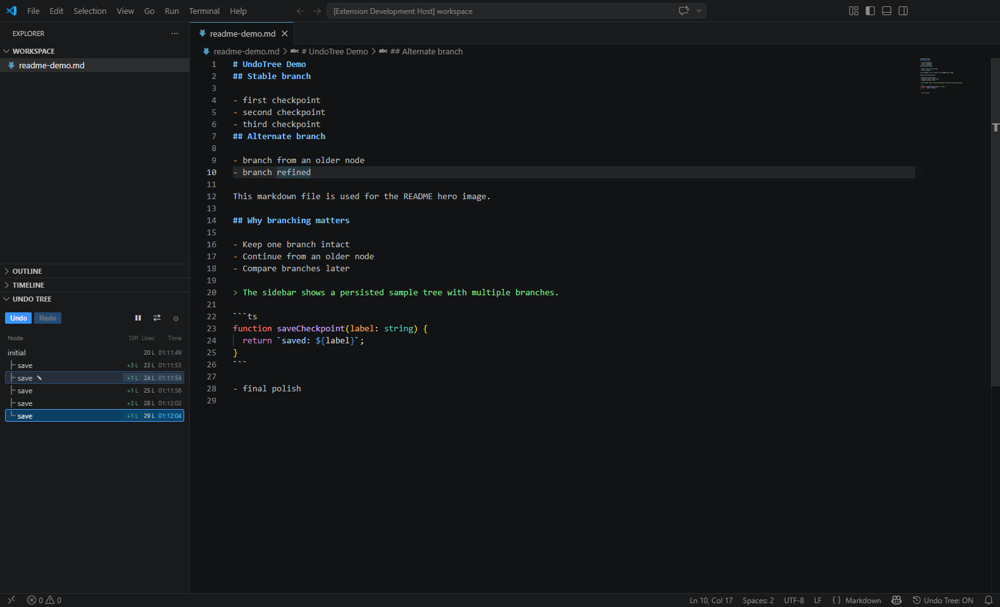
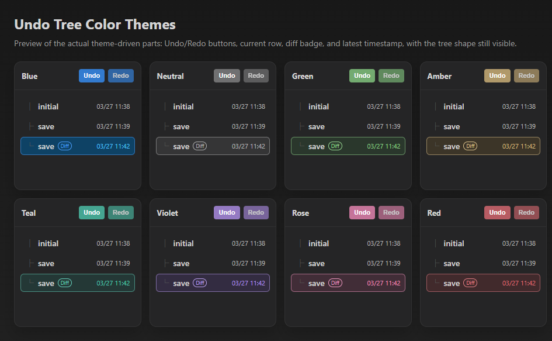
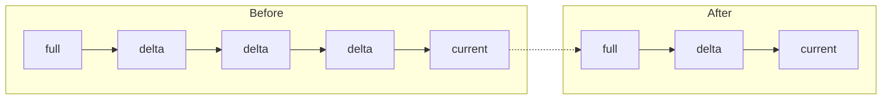
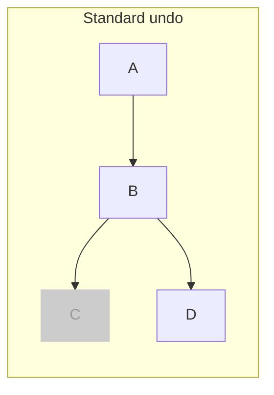
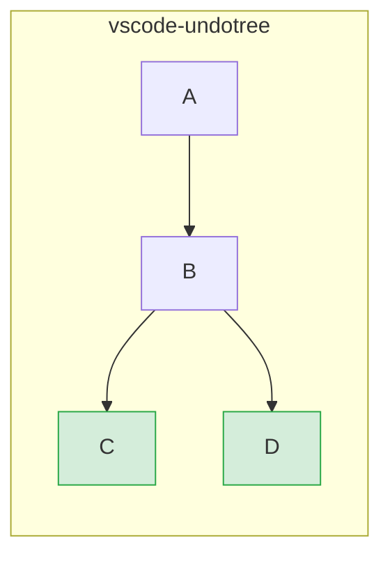
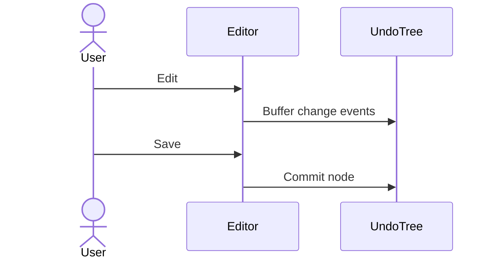
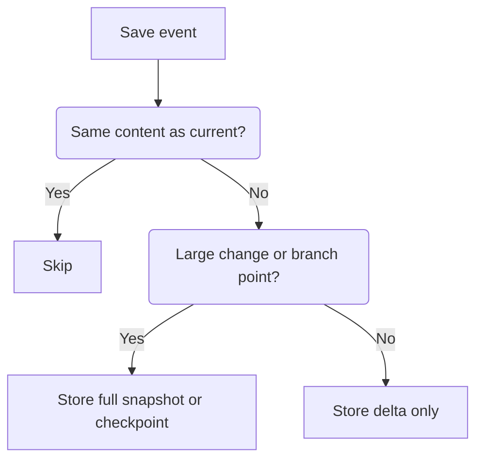

# vscode-undotree

Visualize save-based undo history as a tree in VS Code.

[Japanese README](./README_ja.md)

[Website and settings guide](https://undotree.ruhenheim.org/) · [Visual Studio Marketplace](https://marketplace.visualstudio.com/items?itemName=mmiyaji.vscode-undotree)

## Overview

Unlike standard linear undo/redo, **vscode-undotree** preserves branches. If you jump back to an older point and continue editing, the previous future remains available as another branch.

The extension records history on saves and periodic autosave checkpoints. It does not replace VS Code's native undo stack; it adds a separate history layer for navigating meaningful states.

Native Undo/Redo also updates the tree selection. Before following an undo or redo, pending tracked edits are kept as a history state, so undoing and typing a new version preserves the previous future as another branch. If the native undo group lands between checkpoints, that state is recorded too. Ordinary typing continues to use save-based and periodic checkpoints; this does not record every keystroke as a node. These states use the same persistence and compaction rules as other history nodes.



## Color Themes

`undotree.colorTheme` lets you switch the sidebar accent theme. The default is `blue`. `auto` follows the active VS Code theme and improves text contrast on light themes. Additional built-in themes are `neutral`, `green`, `amber`, `teal`, `violet`, `rose`, and `red`.



## Features

- Tree-structured history with preserved branches
- Save-triggered checkpoints and periodic autosave checkpoints
- Sidebar navigation with keyboard support
- Diff mode for comparing against the current document or between arbitrary nodes
- Node notes and pinned nodes for important history points
- Line-count or byte-count metrics per node, including parent-relative deltas
- Relative timestamp display
- Manual and automatic persistence across sessions
- Compact / Hard Compact with preview, validation, and manual keep/remove overrides
- Diagnostics panel for persisted storage, manifest state, locks, and orphan files
- Multi-window conflict warnings in auto persistence mode
- Adaptive persistence with compression, checkpoint files, and lazy loading
- Idle resident-tree unload for persisted clean trees to reduce memory usage
- Runtime language override for the sidebar UI (`auto`, `en`, `ja`)
- History preservation across file rename and move operations

## Installation

Install **UndoTree History** by **mmiyaji** from [Visual Studio Marketplace](https://marketplace.visualstudio.com/items?itemName=mmiyaji.vscode-undotree).

1. Open the Marketplace listing and select **Install**.
2. Open the extension in VS Code, confirm the publisher, and install it.

Alternatively, search the Extensions view for `@id:mmiyaji.vscode-undotree`. For manual installation, download a `.vsix` from [GitHub Releases](https://github.com/mmiyaji/vscode-undotree/releases) and run `Extensions: Install from VSIX...`.

## Usage

| Action | Method |
|--------|--------|
| Open Undo Tree panel | Explorer -> **Undo Tree** |
| Focus panel | `Ctrl+Shift+U` |
| Create checkpoint | Save the file |
| Undo / Redo | Click **Undo** / **Redo** |
| Jump to a node | Click the node row |
| Compare with current | Switch to **Diff** and select a node |
| Compare between two nodes | Switch to **Diff**, choose **Pair Diff**, select a base node, then select another node |
| Pause / Resume tracking | Click **Pause** / **Resume** |
| Open actions menu | Click the gear button |
| Choose tracking, persistence, or history actions | Click the status bar item |
| Find history by note or date / show only pinned nodes | Click **Search** and use the search field or pinned filter |
| Reveal the current node and clear filters | Click **Current** |
| Collapse / expand a branch | Click the chevron at the start of a branch, or use `Left` / `Right` on that row |

The graph column uses 14–44 pixels according to the number of lanes in the complete history. All rows share that width, so labels and the Current badge stay aligned; folding and filtering do not change it. Only the starts of branches at a fork have disclosure controls; ordinary linear saves use dots. A collapsed branch shows the number of hidden states. Up to four graph lanes are drawn; additional lanes share the outer rail while navigation and folding retain the actual node relationships.

Branch folding is kept separately for each file in the webview state. Search and the pinned filter include matching nodes inside collapsed branches without changing the folding state. **Current** clears filters and expands the current node's ancestors; history navigation also reveals the selected node. Virtual scrolling applies to the remaining visible rows after folding and filtering.

### Panel layout

The sidebar shows a tree of save checkpoints. The highlighted row is the current position. Optional node metadata can include:

- Timestamp
- Storage kind badge (`F` / `D`)
- Line or byte delta
- Note marker
- Pin marker

### Status bar

The status bar item shows tracking state for the current file:

Click it to open the action menu, including pause/resume, file-type tracking, automatic/manual persistence, explicit save/restore, and compaction previews. The tooltip shows tracking state and the persistence mode. Switching persistence mode updates an existing workspace override, or otherwise your user settings; it does not delete saved history.

| Display | Meaning |
|---------|---------|
| `$(history) Undo Tree: ON` | Current file is tracked |
| `$(circle-slash) Undo Tree: OFF` | Current file is not tracked |
| `$(debug-pause) Undo Tree: PAUSED` | Tracking is paused globally |

### Keyboard shortcuts

The shortcuts below apply when the history tree has focus. Text fields and buttons keep their normal keyboard behavior. `Tab` / `Shift+Tab` moves between controls.

| Key | Action |
|-----|--------|
| `Up` / `k` | Move focus up |
| `Down` / `j` | Move focus down |
| `Left` | Collapse an expanded branch, otherwise move focus to parent |
| `Right` | Expand a collapsed branch, otherwise move focus to last child |
| `Tab` / `Shift+Tab` | Move to next / previous control |
| `Home` / `End` | Move to first / last node |
| `Enter` / `Space` | Jump to focused node, or compare in Diff mode |
| `u` / `r` | Undo / Redo |
| `d` | Toggle Navigate / Diff mode |
| `b` | Set the base node for Pair Diff |
| `c` | Return to `vs Current` diff mode |
| `p` | Toggle Pause / Resume |
| `n` / `N` | Move to next / previous noted node |
| `?` | Show the shortcut help overlay |
| `Esc` | Close help or exit Diff mode |

### Context menu

Right-click a node to open actions such as:

- `Jump`
- `Compare with Current`
- `Set Pair Diff Base`
- `Pin / Unpin`
- `Edit Note`
- `Display Settings`

### Actions menu

The menu includes:

- `Open Settings`
- `Save Persisted State`
- `Restore Persisted State`
- `Compact History`
- `Compact History Preview`
- `Hard Compact`
- `Hard Compact Preview`
- `Pause Tracking` / `Resume Tracking`
- `Toggle Tracking for This Extension`
- `Reset All State`

## Persistence

Persisted history is stored in the extension storage directory, not in the workspace by default.

The default `persistenceMode` is `auto`: history is recorded in memory and saved to disk after history changes, with a one-second debounce to combine writes. Pending history is also saved during normal extension shutdown. An explicit `manual` setting is respected; in that mode, use **Save Persisted State** to save history to disk. The default 30-second `autosaveInterval` creates periodic history checkpoints; it does not enable VS Code's file Auto Save setting. Setting it to `0` disables periodic checkpoints, while ordinary file saves still record history.

History contains previous file contents, including states captured by periodic checkpoints before a file save. It remains in the extension storage directory after restarting VS Code. Use **Reset All State** to delete the extension's saved history. `hardCompactAfterDays` defaults to `0`, disabling the Hard Compact command. A positive value sets the command's age threshold; it does not schedule automatic deletion.

Saved data is split per tracked file:

- `undo-trees/manifest.json`
- `undo-trees/manifest.json.bak`
- `undo-trees/<file-hash>.json`
- `undo-trees/content/<hash>` for large checkpoint content

Behavior:

- `Save Persisted State` writes the current tracked trees to disk
- `Restore Persisted State` reloads the saved tree for the active file
- Opening a tracked file reloads its saved tree on demand
- If the file content matches an existing history node, that node becomes current and its other branches are retained; otherwise a new `restore` node is appended
- Root-only untouched trees are not persisted until history actually grows
- `manifest.json.bak` is used as a fallback if the main manifest cannot be read
- Persisted files are written through temporary files first to avoid leaving zero-byte history files behind on interrupted writes
- Broken persisted tree topology is repaired on load when possible so content can be recovered without dropping the entire history

### Storage maintenance

Routine scheduled cleanup is not required for normal use. Saves update changed trees and leave unloaded histories unread; the shared manifest and tree-directory listing still grow with the number of tracked files. Very long individual histories also increase serialization, merging and reconstruction costs. The document size limit does not cap history length or total disk usage.

Use **Compact History** to simplify a long history. To discard older eligible history, set `hardCompactAfterDays` and review **Hard Compact Preview** before running the command. These commands reorganize or remove history nodes; they do not guarantee all old checkpoint blobs are deleted immediately.

Checkpoint content blobs are retained during saves because another window can still need them. If disk usage becomes significant, inspect Diagnostics and use **Prune Orphan Files** to remove unreferenced files. The cleanup verifies references and skips content deletion while a live history lock exists. Close other windows using this history and allow their locks to expire before retrying. Referenced history is retained. Diagnostics and cleanup perform a full storage scan, so run them when needed rather than on every save.

## Compaction

`Compact History` reduces noise in long linear chains by removing compressible middle nodes.

Current behavior:

- Simple middle nodes in a straight chain can be removed
- Branch points are kept
- Leaf nodes are kept
- The current node is kept
- Pinned nodes and noted nodes are protected
- `mixed` nodes are kept

`Hard Compact` also protects the latest-timestamp node, even when it is not the current node.

`mixed` means a node that is not part of a pure insert-only or pure delete-only chain. Full snapshot nodes are treated as `mixed`, and delta nodes that contain both insertion and deletion are also treated as `mixed`.



### Compact preview

The preview panel shows:

- Removable nodes
- Protected nodes
- An `ALL` tree view
- Reason summaries
- Manual `Keep` / `Remove` overrides
- Validation and cleanup actions from Diagnostics when needed

## Diagnostics

Undo Tree includes a diagnostics panel for persisted storage maintenance. It is intended for development mode or when `undotree.enableDiagnostics` is enabled.

The panel can show:

- Manifest status
- Manifest backup status
- Persisted tree and content file counts
- Orphan tree/content files
- Missing or unreadable tree files
- Missing content hashes
- Multi-window lock status

Available actions include:

- `Validate Persisted Storage`
- `Prune Orphan Files`
- `Rebuild Manifest`
- `Open Storage Folder`
- `Reset All State`

## Rename / move behavior

Undo Tree listens to file rename and move events.

- In-memory history is moved from the old URI to the new URI
- Persisted manifest entries and tree file names are updated to the new URI
- Close/unload is temporarily suppressed during rename so history is not lost mid-operation

## Multi-window behavior

Persistence is shared across VS Code windows because persisted history lives in the same extension storage folder.

- Different files in different windows are generally fine
- The same file in multiple windows is not recommended
- In `auto` persistence mode, Undo Tree can warn if the same tracked file appears active in another VS Code window
- The warning uses short-lived lock files with heartbeat and TTL; it is best-effort protection, not strict locking

## Configuration

Open settings from the actions menu, or search for `@ext:mmiyaji.vscode-undotree` in VS Code settings.

The defaults below describe this checkout's [configuration definitions](./package.json). Existing user, workspace, or workspace-folder settings may override them. For a short introduction and a workspace example, see the [settings guide](https://undotree.ruhenheim.org/#settings).

### General

| Setting | Default | Description |
|---------|---------|-------------|
| `undotree.trackingMode` | `"auto"` | Text files by default; respects explicitly configured lists. `text` always detects text; `listed` uses the lists |
| `undotree.maxTrackedFileChars` | `1000000` | Maximum document length in UTF-16 code units; `0` removes the limit |
| `undotree.enabledExtensions` | Common code, web, configuration, and text extensions | Extensions to track; an explicit list replaces the defaults |
| `undotree.enabledFileNames` | `Dockerfile`, `Makefile`, `README`, `.gitignore`, and common extensionless files | Exact file names to track, case-insensitively. If `enabledExtensions` has a custom value, these defaults are ignored; set this option explicitly to opt file names back in |
| `undotree.excludePatterns` | Common generated, dependency, cache, lock, minified, and private-key paths/files | Exclusions always win. Slashless patterns match any basename as before. Path patterns match workspace-relative paths; `*` and `?` stay within one segment and `**` spans directories. Examples: `generated/**`, `**/cache/**`, `*.min.*` |
| `undotree.persistenceMode` | `"auto"` | `manual` saves only when requested; `auto` saves automatically after history changes |
| `undotree.autosaveInterval` | `30` | Autosave checkpoint interval in seconds (`0` disables it) |
| `undotree.hardCompactAfterDays` | `0` | Age threshold for `Hard Compact`; `0` disables it |
| `undotree.warnOnMultiWindowConflict` | `true` | Show warnings in `auto` mode when the same tracked file appears active in another VS Code window |
| `undotree.language` | `"auto"` | Runtime sidebar language: `auto`, `en`, or `ja` |

The default `trackingMode: auto` tracks opened text documents, including unknown extensions and extensionless files. Explicit `enabledExtensions` or `enabledFileNames` settings preserve list-based tracking. Select `text` to track text regardless of those lists, or `listed` to always use the lists. In list-based tracking, a custom extension array replaces its defaults and suppresses the default file-name list; configure `enabledFileNames` explicitly if needed.

All modes apply exclusions, known binary extensions and a bounded content heuristic, and the document length limit. The binary heuristic samples at most 4096 UTF-16 code units from the beginning and end; it is not a complete file-format detector. The default limit is one million UTF-16 code units (about 2 MB of UTF-16 text; characters such as emoji occupy two units). Oversized documents are rejected before requesting their contents or recording history. Choose **Track this file until closed** in the sidebar to temporarily lift the size limit for that document only, or change `maxTrackedFileChars`. The temporary override still respects exclusions and binary detection; existing history is retained. In text mode, disabling tracking adds the extension or file name to exclusions; edit the matching exclusion to resume tracking.

Default exclusions cover version-control metadata, dependency and generated directories, caches, minified files and source maps, common lockfiles, `.env` files, and private-key names/extensions. Exclusions always win. Slashless patterns such as `*.min.*` match a basename anywhere. Patterns with slashes match paths relative to each document's workspace folder: `generated/**` excludes only a top-level `generated` directory, while `**/cache/**` excludes `cache` directories at any depth. Backslashes in patterns are normalized to `/`. If a file is outside a workspace, path patterns are matched against its normalized absolute path. The tracking settings support workspace-folder scope in multi-root workspaces.

An explicit `excludePatterns` array also replaces its default list. Keep any default exclusions you still need when customizing it. Tracking applies to local `file:` documents; untitled buffers and other URI schemes are not tracked.

<details>
<summary>Full default tracking lists</summary>

These are the list-mode presets and default exclusions. Copying enabledExtensions or enabledFileNames into your settings makes auto mode use list-based tracking. Change only the settings you need.

```json
{
  "undotree.enabledExtensions": [
    ".js", ".jsx", ".mjs", ".cjs", ".ts", ".tsx", ".mts", ".cts", ".vue", ".svelte", ".astro",
    ".py", ".pyw", ".go", ".rs", ".java", ".c", ".h", ".cc", ".hh", ".cpp", ".hpp", ".cxx",
    ".hxx", ".cs", ".rb", ".rake", ".php", ".swift", ".kt", ".kts", ".dart", ".lua", ".sh",
    ".bash", ".zsh", ".fish", ".ps1", ".psm1", ".psd1", ".bat", ".cmd", ".r", ".jl", ".pl",
    ".pm", ".scala", ".sc", ".clj", ".cljs", ".cljc", ".edn", ".ex", ".exs", ".erl", ".hrl",
    ".fs", ".fsx", ".fsi", ".hs", ".sql", ".graphql", ".gql", ".proto", ".tf", ".tfvars",
    ".json", ".jsonc", ".json5", ".yaml", ".yml", ".toml", ".ini", ".cmake", ".html", ".htm",
    ".css", ".scss", ".sass", ".less", ".xml", ".xsd", ".xsl", ".xaml", ".svg", ".txt", ".md",
    ".mdx", ".rst", ".adoc", ".asciidoc", ".tex", ".org", ".properties", ".conf", ".config"
  ],
  "undotree.enabledFileNames": [
    "Dockerfile", "Containerfile", "Makefile", "GNUmakefile", "justfile", "Taskfile", "README",
    "LICENSE", "COPYING", "NOTICE", "AUTHORS", "CONTRIBUTING", "CHANGELOG", ".gitignore",
    ".gitattributes", ".gitmodules", ".editorconfig", ".dockerignore", ".npmrc", ".nvmrc",
    ".node-version", ".python-version", ".ruby-version", ".tool-versions", ".bashrc",
    ".bash_profile", ".zshrc", ".profile", ".inputrc", ".npmignore"
  ],
  "undotree.excludePatterns": [
    "**/.git/**", "**/.hg/**", "**/.svn/**", "**/node_modules/**", "**/bower_components/**",
    "**/vendor/**", "**/dist/**", "**/build/**", "**/out/**", "**/target/**", "**/coverage/**",
    "**/.next/**", "**/.nuxt/**", "**/.output/**", "**/.cache/**", "**/.turbo/**",
    "**/.venv/**", "**/venv/**", "*.min.*", "*.map", "package-lock.json", "npm-shrinkwrap.json",
    "yarn.lock", "pnpm-lock.yaml", "Cargo.lock", "Gemfile.lock", "composer.lock", "poetry.lock",
    "Pipfile.lock", "uv.lock", "bun.lock", "bun.lockb", ".env", ".env.*", "*.pem", "*.key",
    "*.p12", "*.pfx", "id_rsa", "id_dsa", "id_ecdsa", "id_ed25519"
  ]
}
```

</details>

### Display

| Setting | Default | Description |
|---------|---------|-------------|
| `undotree.timeFormat` | `"time"` | `none`, `time`, `dateTime`, `relative`, or `custom` |
| `undotree.timeFormatCustom` | `"yyyy-MM-dd HH:mm:ss"` | Custom timestamp format using [date-fns format](https://date-fns.org/v4.1.0/docs/format); used only when `timeFormat` is `custom` |
| `undotree.showStorageKind` | `false` | Show `F` / `D` badges |
| `undotree.nodeSizeMetric` | `"lines"` | `none`, `lines`, or `bytes` |
| `undotree.nodeSizeMetricBase` | `"parent"` | Compare size against `current`, `initial`, or `parent` |
| `undotree.colorTheme` | `"blue"` | Sidebar accent theme: `blue` / `auto` / `neutral` / `green` / `amber` / `teal` / `violet` / `rose` / `red` |

### Performance

These settings are mainly for advanced tuning. The defaults are recommended unless you have a clear reason to change them.

| Setting | Default | Description |
|---------|---------|-------------|
| `undotree.enableDiagnostics` | `false` | Enable the diagnostics panel outside development mode |
| `undotree.compressionThresholdKB` | `100` | Compress persisted tree files above this size |
| `undotree.checkpointThresholdKB` | `1000` | Split large persisted full snapshots into checkpoint content files above this size |
| `undotree.memoryCheckpointThresholdKB` | `32` | Prefer in-memory checkpoint promotion for large branch snapshots; recommended value: `32` |
| `undotree.contentCacheMaxKB` | `20480` | LRU cache size for checkpoint content |

## Design philosophy

### Standard undo vs. vscode-undotree

Standard undo discards the old future when you edit after undoing.



vscode-undotree preserves both branches:



### Save as the main checkpoint

Instead of recording every keystroke as a primary history unit, vscode-undotree treats file saves as meaningful checkpoints.



### Hybrid storage



### Coexisting with native undo

vscode-undotree does not replace VS Code's built-in undo stack. It adds a separate navigation layer around saved states.

## Requirements

- VS Code 1.90.0 or later

## License

MIT
