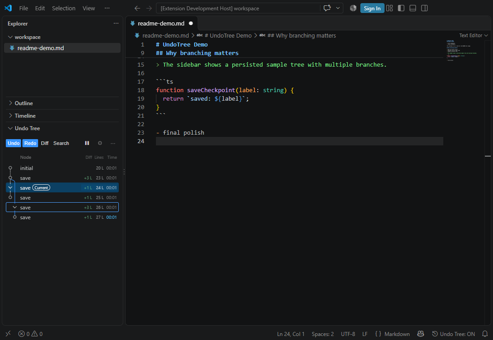
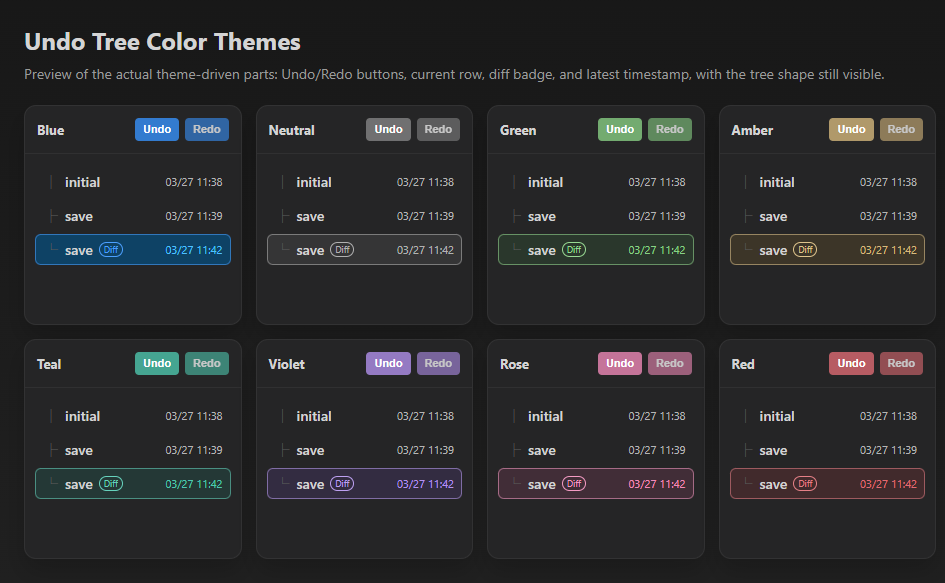
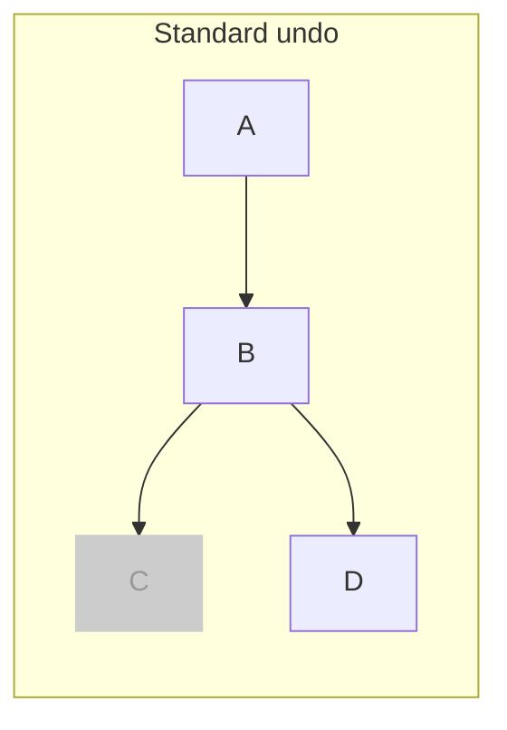
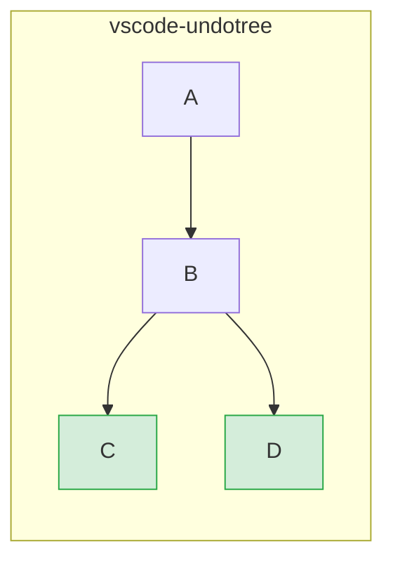
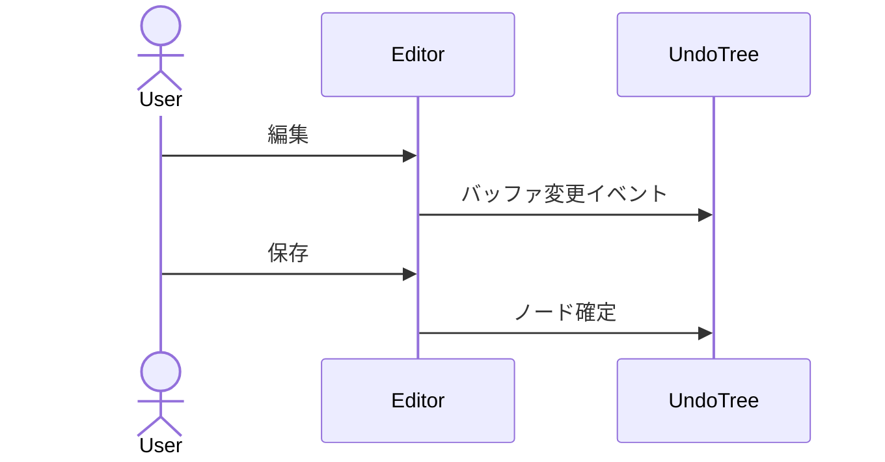
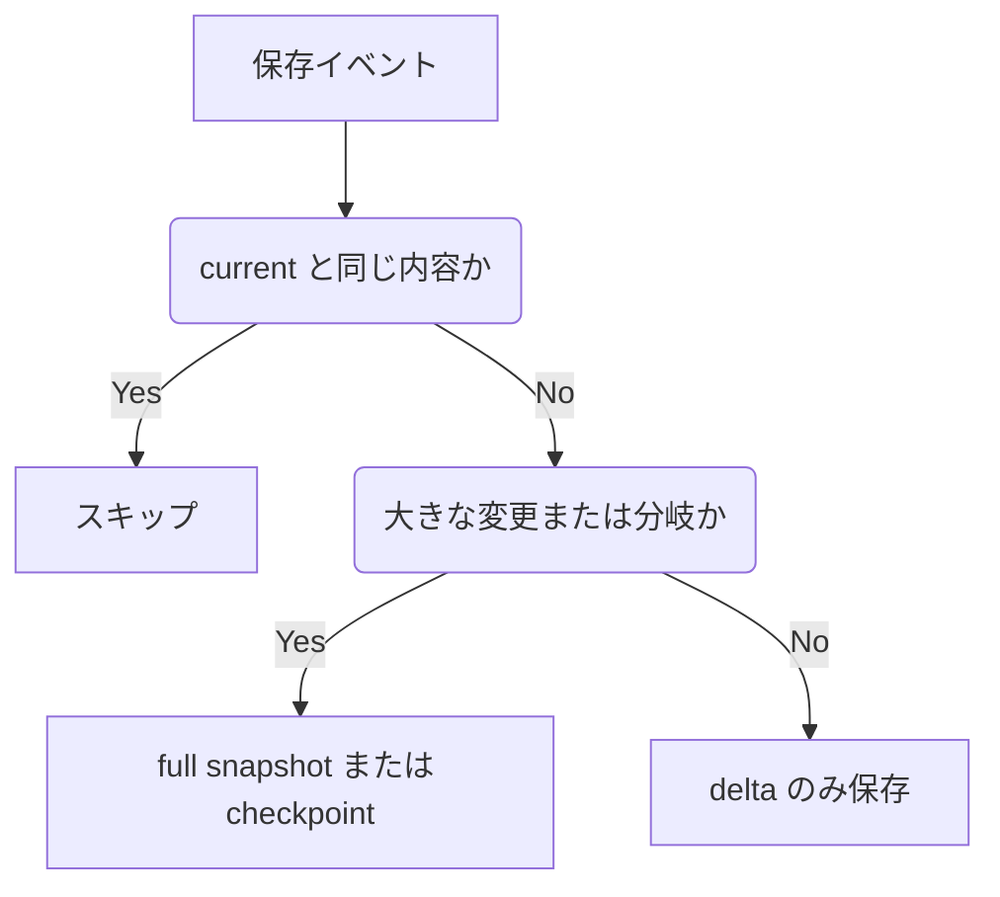

# vscode-undotree

VS Code 上で、保存を基準にした Undo 履歴をツリーとして可視化する拡張です。

[English README](./README.md)

[紹介サイト・設定ガイド](https://undotree.ruhenheim.org/) · [Visual Studio Marketplace](https://marketplace.visualstudio.com/items?itemName=mmiyaji.vscode-undotree)

## 概要

通常の直線的な undo/redo とは異なり、**vscode-undotree** は分岐を保持します。過去の位置に戻って編集を続けても、それまでの未来は別の枝として残ります。

履歴は主にファイル保存時と定期 autosave チェックポイントで記録されます。VS Code 標準の undo スタックを置き換えるのではなく、意味のある保存状態をたどるための別レイヤーとして動作します。

標準 Undo/Redo にもツリーの現在位置が追従します。操作直前の未記録の追跡対象編集を履歴に残すため、Undo 後に別の内容を入力しても、それまでの未来は別の枝として保持されます。標準 Undo の区切りが保存済みチェックポイントの間にある場合は、その状態も記録します。通常の入力は引き続き保存時と定期チェックポイントで記録し、キー入力ごとにノードを作成するものではありません。追加した状態にも既存の永続化・履歴整理のルールが適用されます。



## カラーテーマ

`undotree.colorTheme` でサイドバーのアクセントカラーを切り替えられます。既定値は `blue` で、`auto` は VS Code の現在のテーマに合わせて自動調整します。ライト系テーマでは文字コントラストも強めます。そのほかに `neutral`、`green`、`amber`、`teal`、`violet`、`rose`、`red` も選べます。



## 主な機能

- 分岐を保持するツリー型履歴
- 保存時チェックポイントと定期 autosave チェックポイント
- サイドバー上での履歴移動とキーボード操作
- 現在内容との差分比較、任意ノード間の Pair Diff
- ノードメモとピン留め
- 行数またはバイト数の差分表示。親ノード基準の差分表示にも対応
- 相対時刻表示
- 手動 / 自動の永続化
- Compact / Hard Compact と、そのプレビュー、検証、手動 Keep/Remove
- persisted storage、manifest、lock、孤立ファイルを確認できる Diagnostics 画面
- `auto` 永続化時のマルチウィンドウ競合警告
- 圧縮、checkpoint、lazy load を使った永続化最適化
- persisted 済みで clean な tree の idle unload による省メモリ化
- サイドバー UI の実行時言語切替 (`auto` / `en` / `ja`)
- ファイル rename / move 後の履歴引き継ぎ

## インストール

発行元 **mmiyaji** の **UndoTree History** を [Visual Studio Marketplace](https://marketplace.visualstudio.com/items?itemName=mmiyaji.vscode-undotree) からインストールできます。

1. ストアのページで **Install** を選択します。
2. VS Code で開き、発行元を確認してインストールします。

VS Code の拡張機能ビューで `@id:mmiyaji.vscode-undotree` を検索しても見つかります。手動でインストールする場合は、[GitHub Releases](https://github.com/mmiyaji/vscode-undotree/releases) から `.vsix` を取得し、`Extensions: Install from VSIX...` を実行します。

## 使い方

| 操作 | 方法 |
|------|------|
| Undo Tree パネルを開く | Explorer -> **Undo Tree** |
| パネルへフォーカス | `Ctrl+Shift+U` |
| チェックポイント作成 | ファイルを保存 |
| Undo / Redo | **Undo** / **Redo** ボタン |
| ノードへ移動 | ノード行をクリック |
| 現在内容との差分を見る | **Diff** モードでノードを選択 |
| ノード間比較 | **Diff** -> **Pair Diff** -> 基準ノード選択 -> 比較先ノード選択 |
| 一時停止 / 再開 | **Pause** / **Resume** |
| アクションメニューを開く | ギアボタン |
| 追跡・永続化・履歴整理の操作を選択 | ステータスバー項目をクリック |
| 名前・メモ・日時で履歴を検索 / ピン留めだけ表示 | **Search** から検索欄・ピン留めフィルターを使う |
| フィルターを解除して現在のノードを表示 | **その他の操作 → 現在の履歴へ** |
| 枝の折りたたみ / 展開 | 枝の先頭の矢印、またはその行で `Left` / `Right` |

グラフ欄は履歴全体のレーン数に応じて14〜44pxに調整します。同じツリー内では幅を統一し、折りたたみや検索では変えないため、ラベルとCurrentの位置が揃います。開閉矢印は分岐から始まる枝の先頭だけに表示し、直線上の保存状態は点で表します。折りたたんだ枝には非表示件数を表示します。グラフは最大4レーンで、それ以上は外側の線を共有しますが、履歴移動・折りたたみは実際のノード関係を維持します。

折りたたみ状態はファイルごとに Webview の状態として保持します。検索・ピン留めフィルターは折りたたんだ枝の中も対象にし、解除すると元の折りたたみ状態に戻ります。**現在の履歴を表示** はフィルターを解除して現在ノードの祖先を展開します。履歴移動時も移動先のノードを表示します。仮想スクロールは、折りたたみと絞り込みを適用した後の可視行一覧に対して動作します。

ヘッダーには Undo・Redo・Diff 切り替えを常に表示します。幅が足りない操作は「その他の操作」に移し、広げるとヘッダーに戻ります。履歴を横スクロールしてもヘッダーは画面内に留まります。

既定のスマート時刻表示は、今日を `HH:mm`、昨日を「昨日 HH:mm」、今年の過去日を `MM/dd HH:mm`、他の年を `yyyy/MM/dd` で表示します。ホバーで正確なローカル日時を確認できます。既に明示した時刻形式の設定は維持します。

### パネル表示

サイドバーには保存履歴のツリーが表示されます。ハイライトされた行が現在位置です。必要に応じて次の情報を表示できます。

- タイムスタンプ
- ストレージ種別バッジ (`F` / `D`)
- 行数またはバイト数の差分
- メモ
- ピン留め

### ステータスバー

ステータスバー項目は、現在ファイルの追跡状態を表示します。

クリックすると、一時停止／再開、ファイル形式の追跡設定、自動／手動の永続化、履歴の保存／復元、コンパクションとプレビューを選べます。ツールチップには追跡状態と永続化モードを表示します。永続化モードは、既存のワークスペース設定があればその設定を、それ以外はユーザー設定を更新します。切り替えても保存済み履歴は削除しません。

| 表示 | 意味 |
|------|------|
| `$(history) Undo Tree: ON` | 現在のファイルは追跡対象 |
| `$(circle-slash) Undo Tree: OFF` | 現在のファイルは追跡対象外 |
| `$(debug-pause) Undo Tree: PAUSED` | 履歴記録をグローバルに一時停止中 |

### キーボード操作

以下のキーは履歴ツリーにフォーカスがあるときに使えます。入力欄やボタンでは通常のキー操作を維持します。`Tab` / `Shift+Tab` はコントロール間を移動します。

| キー | 操作 |
|------|------|
| `Up` / `k` | 上へ移動 |
| `Down` / `j` | 下へ移動 |
| `Left` | 展開済みの枝を折りたたむ。それ以外は親へ移動 |
| `Right` | 折りたたんだ枝を展開する。それ以外は最後の子へ移動 |
| `Tab` / `Shift+Tab` | 次 / 前のコントロールへ移動 |
| `Home` / `End` | 最初 / 最後のノードへ移動 |
| `Enter` / `Space` | フォーカス中のノードへジャンプ。Diff モードでは差分を比較 |
| `u` / `r` | Undo / Redo |
| `d` | Navigate / Diff モード切替 |
| `b` | Pair Diff の基準ノード設定 |
| `c` | `vs Current` に戻る |
| `p` | Pause / Resume |
| `n` / `N` | 次 / 前のメモ付きノードへ移動 |
| `?` | ショートカット一覧オーバーレイ表示 |
| `Esc` | 検索を解除して閉じる / ヘルプを閉じる / Diff モードを終了 |

### 右クリックメニュー

ノードを右クリックすると、次の操作を選べます。

- `Jump`
- `Compare with Current`
- `Set Pair Diff Base`
- `Pin / Unpin`
- `Edit Note`
- `Display Settings`

### アクションメニュー

アクションメニューには次があります。

- `Open Settings`
- `Save Persisted State`
- `Restore Persisted State`
- `Compact History`
- `Compact History Preview`
- `Hard Compact`
- `Hard Compact Preview`
- `Pause Tracking` / `Resume Tracking`
- `Toggle Tracking for This Extension`
- `Reset All State`

## 永続化

永続化された履歴はワークスペースではなく、拡張の storage ディレクトリへ保存されます。

`persistenceMode` の既定値は `auto` です。履歴はメモリ上に記録され、履歴更新後に1秒待ってディスクへの書き込みをまとめます。通常の終了時にも未保存の履歴を保存します。明示的に指定した `manual` は維持され、その場合は **Save Persisted State** で永続化します。既定で30秒の `autosaveInterval` は履歴の定期チェックポイントを作る設定で、VS Code のファイルの自動保存とは別です。`0` にすると定期記録を無効にできますが、ファイル保存時の履歴記録は続きます。

履歴には過去のファイル本文と、定期チェックポイントでファイル保存前に記録した内容が含まれます。VS Code の再起動後も拡張のストレージに残ります。保存済み履歴を削除するには **Reset All State** を使います。`hardCompactAfterDays` の既定値 `0` は Hard Compact コマンドを無効にします。正の値はコマンドで使う日数の閾値で、自動削除のスケジュールではありません。

保存データは tracked file ごとに分かれます。

- `undo-trees/manifest.json`
- `undo-trees/manifest.json.bak`
- `undo-trees/<file-hash>.json`
- `undo-trees/content/<hash>`（大きい checkpoint content）

挙動:

- `Save Persisted State` は現在の tracked tree をディスクへ保存します
- `Restore Persisted State` はアクティブファイルの保存済み tree を読み戻します
- tracked file を開くと、保存済み tree をオンデマンドで読み込みます
- ファイル内容が既存ノードと一致する場合は、そのノードを現在位置にして他の枝も保持します。一致する履歴がなければ新しい `restore` ノードを追加します
- root だけで履歴がまだ伸びていない tree は保存しません
- `manifest.json` が読めないときは `manifest.json.bak` を使い、Diagnostics でインデックスを修復するまで保存と整理を停止します
- interrupted write で 0 バイトの履歴ファイルが残らないよう、一時ファイル経由で保存します
- 壊れた persisted tree topology は、可能な範囲で修復してから読み込みます

### 保存領域のメンテナンス

通常利用で定期的な削除は必須ではありません。保存では変更したツリーを更新し、未読込の履歴本文は読みません。ただし共通マニフェストとツリーディレクトリの一覧は、追跡ファイル数に応じて大きくなります。1ファイルの履歴が長くなると、シリアライズ・マージ・復元の負荷も増えます。文書サイズの上限は、履歴数やディスク使用量の上限ではありません。

長い履歴の整理には **Compact History** を使います。古い履歴を削除する場合は `hardCompactAfterDays` を指定し、**Hard Compact Preview** で対象を確認してから実行してください。これらは履歴ノードを整理する操作で、古いチェックポイントファイルがすべて即座に削除されるとは限りません。

別ウィンドウが参照している可能性があるため、保存時にはチェックポイントの内容ファイルを保持します。Diagnostics で未参照ファイルを確認し、**Prune Orphan Files** でツリーファイルを整理できます。参照を検証し、未参照のツリーファイルを整理します。内容ファイルは、他のウィンドウが必要とする可能性があるため保持します。参照中の履歴は保持します。診断と整理は保存領域全体を走査するため、毎回の保存時ではなく、必要なときに実施してください。

## コンパクション

`Compact History` は、長い直列チェーンのノイズを減らすために圧縮可能な中間ノードを削減します。

現在のルール:

- 直列チェーン中の単純な中間ノードは削除候補
- 分岐点は保持
- leaf ノードは保持
- current ノードは保持
- pinned ノードと noted ノードは保護
- `mixed` ノードは保持

`Hard Compact` は `current` に加えて、最新タイムスタンプのノードも保護します。

### Compact Preview

プレビュー画面では次を確認できます。

- 削除候補ノード
- 保護ノード
- `ALL` ツリー表示
- 理由サマリ
- 手動 `Keep` / `Remove`
- 必要に応じた validation / cleanup 操作

## Diagnostics

Undo Tree には persisted storage 用の Diagnostics 画面があります。開発モードか `undotree.enableDiagnostics` を有効にした場合に使えます。

最初に全体の状態を示し、**整合性**には検証結果とインデックス修復、**保存領域**には保存場所と孤立ファイルの整理、**マルチウィンドウのロック**には競合情報をまとめています。判定できない孤立ファイル件数は「不明」と表示します。インデックスを信頼できない場合や既知の孤立ファイルがない場合は、整理ボタンを無効にします。実行時の参照確認も引き続き行います。

障害シミュレーションと全履歴リセットは、**詳細操作**の折りたたみ項目に配置しています。シミュレーションは保存済み Manifest を変更するため、実行前に確認します。処理中は二重実行を防ぎ、更新後も詳細項目の展開状態とスクロール位置を保持します。出力画面や保存フォルダーを開くだけでは、保存領域の再走査を行いません。

表示内容:

- manifest 状態
- manifest backup 状態
- persisted tree / content file 数
- orphan tree / orphan content
- missing / unreadable tree file
- missing content hash
- multi-window lock 状態

主な操作:

- `Validate Persisted Storage`
- `Prune Orphan Files`
- `Rebuild Manifest`
- `Open Storage Folder`
- `Reset All State`

## rename / move 後の挙動

Undo Tree はファイルの rename / move を監視します。

- in-memory tree を旧 URI から新 URI へ移動
- persisted manifest と tree file 名も新 URI に更新
- rename 中は close/unload を一時停止し、履歴を失わないようにする

## マルチウィンドウ挙動

persisted history は同じ extension storage フォルダを使うため、VS Code の複数ウィンドウ間で共有されます。

- 別ファイルを別ウィンドウで使うのは概ね問題ありません
- 同じファイルを複数ウィンドウで使うのは非推奨です
- `auto` 永続化時は、同じ tracked file が別ウィンドウで active になっていると警告できます
- この警告は heartbeat と TTL を使う best-effort lock で、厳密な排他制御ではありません

## 設定

アクションメニューの `Open Settings` から開くか、VS Code 設定で `@ext:mmiyaji.vscode-undotree` を検索してください。

以下は、このチェックアウトの [設定定義](./package.json) に基づく既定値です。既存のユーザー設定・ワークスペース設定・フォルダー設定がある場合は、そちらが優先されます。簡単な説明と設定例は [設定ガイド](https://undotree.ruhenheim.org/#settings) でも確認できます。

### General

| 設定 | 既定値 | 説明 |
|------|--------|------|
| `undotree.trackingMode` | `"auto"` | 既定はテキスト全般。明示した対象リストがあれば尊重。`text` はテキスト全般、`listed` は指定リスト |
| `undotree.maxTrackedFileChars` | `1000000` | 文書長の上限（UTF-16単位）。`0` で解除 |
| `undotree.enabledExtensions` | 一般的なコード、Web、設定、テキストの拡張子 | 追跡対象の拡張子。明示した配列で既定値を置き換えます |
| `undotree.enabledFileNames` | `Dockerfile`、`Makefile`、`README`、`.gitignore` など | 大文字小文字を区別せず完全一致するファイル名を追跡します。`enabledExtensions` に独自の値を設定すると既定のファイル名は無効になります。明示的にこの設定を指定するとファイル名を追跡できます |
| `undotree.excludePatterns` | 生成物、依存関係、キャッシュ、lock、minified、秘密鍵に関する一般的なパターン | 除外設定は常に優先されます。スラッシュなしは従来どおり任意のファイル名に一致します。パスパターンはワークスペース相対パスに一致し、`*` と `?` は1階層内、`**` は複数階層に一致します。例: `generated/**`、`**/cache/**`、`*.min.*` |
| `undotree.persistenceMode` | `"auto"` | `manual` は明示保存のみ、`auto` は履歴更新後に自動保存 |
| `undotree.autosaveInterval` | `30` | autosave チェックポイント間隔（秒）。`0` で無効 |
| `undotree.hardCompactAfterDays` | `0` | `Hard Compact` の日数閾値。`0` で無効 |
| `undotree.warnOnMultiWindowConflict` | `true` | `auto` モードで、同じ tracked file が別ウィンドウで active のとき警告 |
| `undotree.language` | `"auto"` | 実行時 UI 言語。`auto` / `en` / `ja` |

既定の `trackingMode: auto` は、未知の拡張子や拡張子なしを含め、開いたテキスト文書を追跡します。既存の `enabledExtensions` または `enabledFileNames` が明示されている場合は指定リストを使います。`text` を選ぶと既存のリストによらずテキスト全般を、`listed` を選ぶと常にリストを対象にします。リスト方式では、独自の拡張子配列が既定値を置き換え、既定のファイル名は無効になります。必要な `enabledFileNames` は明示してください。

全方式で除外設定、既知のバイナリ拡張子と限定的な内容判定、文書長の上限を適用します。バイナリ判定は先頭・末尾の計最大4096 UTF-16単位を使うヒューリスティックで、完全な形式判定ではありません。既定の上限は100万UTF-16単位（UTF-16テキストで約2MB。絵文字などは2単位）です。上限超過時は本文の取得・履歴記録を行いません。サイドバーの「このファイルを閉じるまで追跡」でその文書だけ上限を一時解除するか、`maxTrackedFileChars` を変更できます。一時解除してもバイナリ判定と除外設定は適用され、既存履歴は削除されません。テキスト全般の方式で追跡をOFFにすると、拡張子またはファイル名を除外リストに追加します。再開するには該当する除外設定を変更してください。

既定の除外対象には、バージョン管理メタデータ、依存関係・生成物・キャッシュのディレクトリ、minified ファイルと source map、一般的な lock file、`.env` ファイル、秘密鍵の名前や拡張子が含まれます。除外設定が常に優先されます。`*.min.*` のようなスラッシュなしのパターンは、任意の場所にある同名ファイルに一致します。スラッシュを含むパターンは各ドキュメントのワークスペースフォルダーからの相対パスに一致します。`generated/**` は最上位の `generated` フォルダーを、`**/cache/**` は任意の階層の `cache` フォルダーを除外します。パターン内のバックスラッシュは `/` に正規化します。ワークスペース外のファイルでは、正規化した絶対パスを使います。追跡設定は、マルチルートワークスペースでフォルダーごとに指定できます。

`excludePatterns` も、独自の配列を指定すると既定のリストを置き換えます。引き続き除外したい既定のパターンも含めて指定してください。追跡対象はローカルの `file:` ドキュメントです。未保存の新規ファイルや、ほかの URI スキームは追跡しません。

<details>
<summary>追跡設定の既定リスト（全項目）</summary>

以下はリスト方式のプリセットと既定の除外設定です。enabledExtensions または enabledFileNames を設定へコピーすると、auto はリスト方式になります。必要な設定だけを変更してください。

```json
{
  "undotree.enabledExtensions": [
    ".js", ".jsx", ".mjs", ".cjs", ".ts", ".tsx", ".mts", ".cts", ".vue", ".svelte", ".astro",
    ".py", ".pyw", ".go", ".rs", ".java", ".c", ".h", ".cc", ".hh", ".cpp", ".hpp", ".cxx",
    ".hxx", ".cs", ".rb", ".rake", ".php", ".swift", ".kt", ".kts", ".dart", ".lua", ".sh",
    ".bash", ".zsh", ".fish", ".ps1", ".psm1", ".psd1", ".bat", ".cmd", ".r", ".jl", ".pl",
    ".pm", ".scala", ".sc", ".clj", ".cljs", ".cljc", ".edn", ".ex", ".exs", ".erl", ".hrl",
    ".fs", ".fsx", ".fsi", ".hs", ".sql", ".graphql", ".gql", ".proto", ".tf", ".tfvars",
    ".json", ".jsonc", ".json5", ".yaml", ".yml", ".toml", ".ini", ".cmake", ".html", ".htm",
    ".css", ".scss", ".sass", ".less", ".xml", ".xsd", ".xsl", ".xaml", ".svg", ".txt", ".md",
    ".mdx", ".rst", ".adoc", ".asciidoc", ".tex", ".org", ".properties", ".conf", ".config"
  ],
  "undotree.enabledFileNames": [
    "Dockerfile", "Containerfile", "Makefile", "GNUmakefile", "justfile", "Taskfile", "README",
    "LICENSE", "COPYING", "NOTICE", "AUTHORS", "CONTRIBUTING", "CHANGELOG", ".gitignore",
    ".gitattributes", ".gitmodules", ".editorconfig", ".dockerignore", ".npmrc", ".nvmrc",
    ".node-version", ".python-version", ".ruby-version", ".tool-versions", ".bashrc",
    ".bash_profile", ".zshrc", ".profile", ".inputrc", ".npmignore"
  ],
  "undotree.excludePatterns": [
    "**/.git/**", "**/.hg/**", "**/.svn/**", "**/node_modules/**", "**/bower_components/**",
    "**/vendor/**", "**/dist/**", "**/build/**", "**/out/**", "**/target/**", "**/coverage/**",
    "**/.next/**", "**/.nuxt/**", "**/.output/**", "**/.cache/**", "**/.turbo/**",
    "**/.venv/**", "**/venv/**", "*.min.*", "*.map", "package-lock.json", "npm-shrinkwrap.json",
    "yarn.lock", "pnpm-lock.yaml", "Cargo.lock", "Gemfile.lock", "composer.lock", "poetry.lock",
    "Pipfile.lock", "uv.lock", "bun.lock", "bun.lockb", ".env", ".env.*", "*.pem", "*.key",
    "*.p12", "*.pfx", "id_rsa", "id_dsa", "id_ecdsa", "id_ed25519"
  ]
}
```

</details>

### Display

| 設定 | 既定値 | 説明 |
|------|--------|------|
| `undotree.timeFormat` | `"smart"` | `smart` / `none` / `time` / `dateTime` / `relative` / `custom` |
| `undotree.timeFormatCustom` | `"yyyy-MM-dd HH:mm:ss"` | [date-fns format](https://date-fns.org/v4.1.0/docs/format) 互換。`timeFormat = custom` のときのみ使用 |
| `undotree.showStorageKind` | `false` | `F` / `D` バッジ表示 |
| `undotree.nodeSizeMetric` | `"lines"` | `none` / `lines` / `bytes` |
| `undotree.nodeSizeMetricBase` | `"parent"` | サイズ差分の基準。`current` / `initial` / `parent` |
| `undotree.colorTheme` | `"blue"` | サイドバーのアクセントテーマ。`blue` / `auto` / `neutral` / `green` / `amber` / `teal` / `violet` / `rose` / `red` |

### Performance

これらは主に高度な調整用です。特別な理由がない限り既定値を推奨します。

| 設定 | 既定値 | 説明 |
|------|--------|------|
| `undotree.enableDiagnostics` | `false` | 開発モード外でも Diagnostics 画面を有効化 |
| `undotree.compressionThresholdKB` | `100` | これを超える persisted tree file を圧縮 |
| `undotree.checkpointThresholdKB` | `1000` | 大きい full snapshot を checkpoint content file へ分離する閾値 |
| `undotree.memoryCheckpointThresholdKB` | `32` | 大きい branch snapshot の in-memory checkpoint 化閾値。推奨値は `32` |
| `undotree.contentCacheMaxKB` | `20480` | checkpoint content の LRU cache サイズ |

## 設計補足

### 通常 undo との違い

通常の undo は分岐を保持しませんが、vscode-undotree は分岐を残します。





### 保存を主チェックポイントとする理由

すべてのキー入力を主履歴にするとノイズが増えるため、Undo Tree は保存を意味のあるチェックポイントとして扱います。



### ハイブリッド保存形式



### native undo との共存

vscode-undotree は VS Code 標準の undo stack を置き換えません。保存単位の履歴を中長期でたどるための補助ナビゲーションレイヤーとして共存します。

## 要件

- VS Code 1.90.0 以上

## ライセンス

MIT
