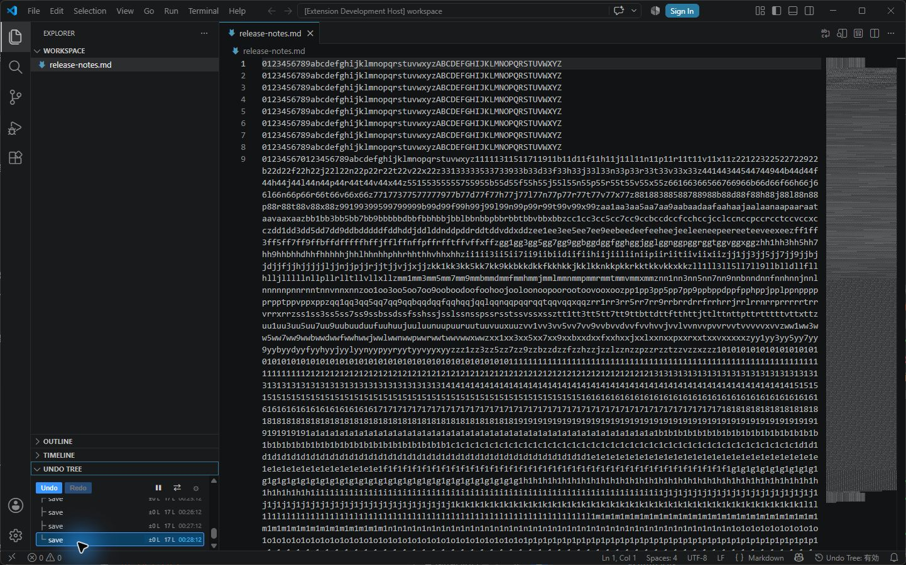
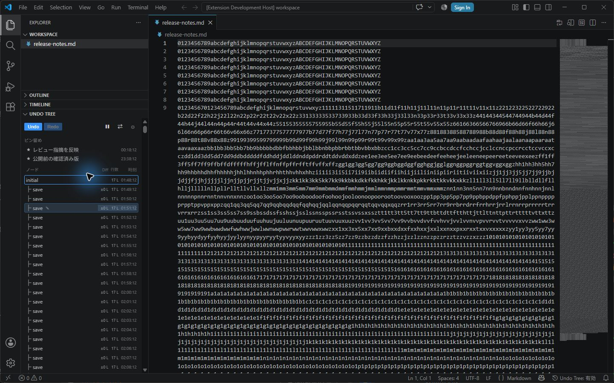
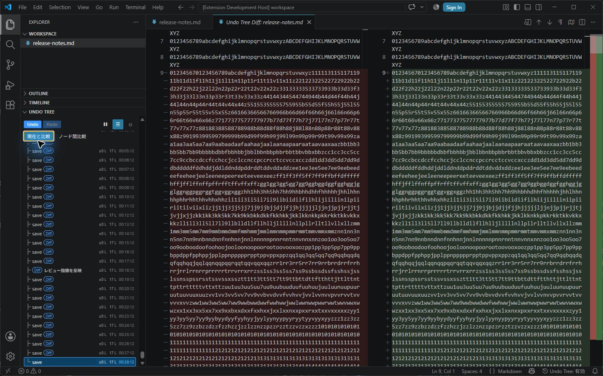

# UndoTree UIレビュー — 2026-09-29

履歴の表示、Homeでの移動、メモ付き履歴の差分表示は実機で動作した。優先する改善は、キーボード操作、現在位置・比較対象の明示、大量履歴の検索。既存のツリー、ピン留め、VS Code標準の差分エディタは活かせる。

## 確認条件

- 現在の作業ツリーをビルドした拡張を、WindowsのVS Code Extension Development Hostで起動。
- 専用の一時プロファイルと検証ファイルを使用。拡張の表示言語は日本語、VS Code本体は英語、ダークテーマ。
- 保存形式の検証用データから10,001ノードを読み込み、2件に日本語メモ・ピンを設定。日時は複数日にまたがる1分間隔に調整した人工データ。
- 約300px幅のサイドバーで、初期の低いペインと、高さを広げたペインを確認。
- 以下の画像は今回の実機操作で新しく取得し、保存した原画像を再確認したもの。過去の性能測定の画面は証拠として使用していない。

## 確認した流れ

### 1. 低いサイドバーで現在の履歴を確認 — 表示は動くが見通しに課題

現在の行は青く表示され、Undo/Redoが上部に残る点は良い。一方、約130pxのペインでは見える履歴は数行で、列見出しやピン留めはスクロールの外にある。「現在」の文字や履歴件数もなく、位置の把握を色とスクロールに頼る。9〜10px程度の補助文字は小さく薄い。コントラスト比の適合判定はしていない。

### 2. 履歴を広げ、先頭とピン留めを見る — ピンは有用、検索性に課題

Homeで先頭の履歴へ移動でき、さらに上へスクロールすると名前付きのピン留めが見える。メモは通常のsave行より識別しやすい。ただし、未注釈の行はsaveと時刻が繰り返される。日付が既定表示に出ないため、複数日にまたがる履歴を見分けにくい。先頭付近では現在の履歴は画面外になり、明示的な「現在を表示」操作もない。

メモ検索・日付の区切り・ピンのみ表示を追加すると、大量履歴を保持する価値が使いやすさにつながる。既存の日時表示設定やメモ間移動ショートカットはあるため、それらが存在しないという指摘ではなく、通常画面からの見つけやすさを改善する提案。

### 3. メモ付き履歴を現在と比較 — 比較は動くが対象の説明とTab操作に課題

「現在と比較」を選び、「レビュー指摘を反映」の履歴をクリックするとVS Codeの差分エディタが開いた。変更箇所の表示は明確。ただしタブ名はファイル名だけで、どの日時の版が左・右なのかは常時表示されない。サイドバーには多数のDiffバッジが並び、選んだ比較対象の識別には寄与しにくい。

比較ボタンをクリック後、Tabを2回押しても「現在と比較」にフォーカス枠が残った。コードではdocument全体でTabをpreventDefaultして兄弟ノード移動に使っている。ボタン上のEnter/Spaceも同じハンドラが履歴操作として処理するため、標準ボタン操作との競合がある。Enter/Spaceの全ケースやスクリーンリーダーの読み上げは今回実機検証していない。

## 改善候補と優先順位

| 優先 | 改善 | 具体案 | 根拠 |
|---|---|---|---|
| 最優先 | Tab・Enterの標準操作を守る | 履歴用のキー処理をツリーに限定。Tabは次の操作へ移動し、兄弟移動は別のキーにする。現在・選択・階層を支援技術へ伝える | 手順3、キーハンドラ、履歴行のHTML |
| 高 | 現在位置と比較対象を明示 | 「現在」バッジと「現在を表示」を追加。「履歴移動／差分比較」を文字で区別。比較中は「左: メモ・日時 ↔ 右: 現在」などを固定表示 | 手順1〜3 |
| 高 | 大量履歴を探せるようにする | メモ・日時の絞り込み、日付境界、ピンのみ表示。件数を表示し、名前のない履歴にも日時で辿れる手掛かりを与える | 手順2 |
| 中 | 補助情報の意味を正確にする | Diff列を「行数差（親と比較）」などに変更。±0は内容変更なしを意味しないと分かる説明を付ける。全行のDiffバッジは選択対象・基準の表示へ整理 | 手順2・3、formatSizeDiff |
| 中 | 狭い領域で重要情報を優先 | ファイル名、現在位置、履歴名を優先し、総行数などは幅に応じて省略。補助文字のサイズ・濃さを見直す。ピン領域には折り畳みや高さ上限を設ける | 手順1〜3 |

「履歴移動」でクリックすると内容が切り替わり、「差分比較」では閲覧になる。この違いは明示したい。既存ユーザーの操作を急に変えるより、まずモード名と対象を明確にするのが小さく導入できる改善。単クリックをすべてプレビューへ変更する案は、別途操作性を確認してから判断する。

## 実装上の注意点

- `src/undoTreeProvider.ts:1330` のdocumentキーハンドラ、`:1371` のTab処理を見直す。`:1539` の履歴行はdivで、`:1279` のフォーカス移動は見た目の更新が中心。ツリーの役割・現在位置・選択位置を伝える属性と実際のフォーカス管理が必要。
- `src/extension.ts:3806` と`:3836` は差分エディタの呼び出し。比較日時やメモを表示名に含める候補。
- `src/undoTreeProvider.ts:1077` の指標は行数またはバイト数の差であり、編集された行数ではない。今回も内容に差があるのに±0 Lが並ぶ。
- `src/undoTreeProvider.ts:1563` で比較可能なほぼ全行にDiffバッジを付けている。選択中・比較基準だけに意味のある表示を絞れる。
- 検索のために全履歴の本文を復元してはならない。まずメモ・日時など既存メタデータだけを検索し、前段の性能改善で導入した仮想表示を維持する。全文検索は別の性能設計が必要。
- 日付グループを追加する場合、分岐の親子関係が崩れる単純な日付順ソートは避ける。まず日付境界のラベルと絞り込みから始める。

## 確認範囲の限界

今回は大量の直線履歴、ピン・メモの表示、現在との比較、低いペイン、HomeとTabを確認した。分岐の複雑な配置、ノード間比較の全手順、Compact操作、ライト／高コントラストテーマ、拡大表示、スクリーンリーダーは未検証。画面とソースからのアクセシビリティリスクの指摘であり、適合性の認証ではない。

本レビューで追加したのは報告書と証拠画像。UI実装の変更は行っていない。次の実装は、標準キー操作の修正と現在位置・比較対象の明示を先行させ、その後にメタデータ検索を追加する順序を推奨する。
